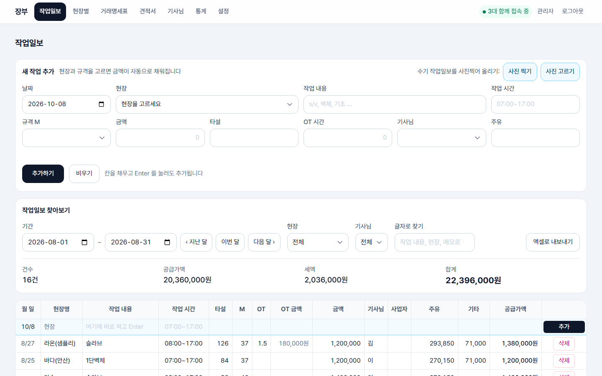
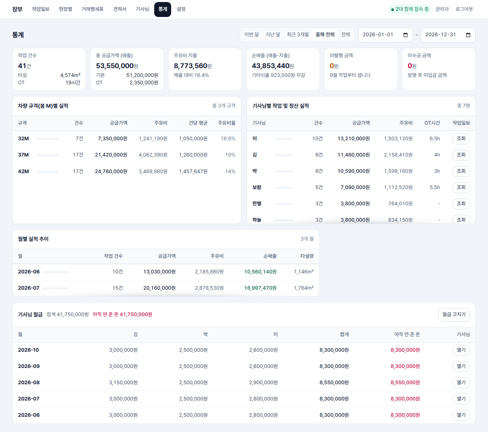
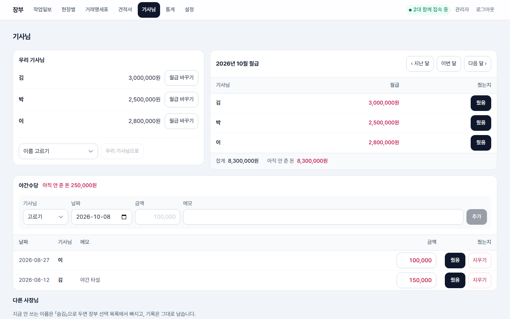
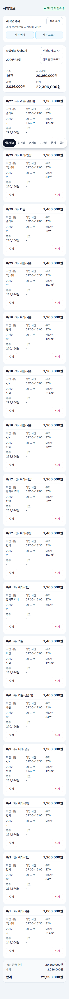

# 장부 · 거래명세표

펌프카 작업 장부를 기록하고, 현장·기간별로 묶어 **거래명세표**와 **견적서**를 발행·인쇄하는 웹앱입니다.
실제로 쓰고 있는 앱에서 거래 자료를 모두 지어낸 값으로 바꿔 공개한 사본입니다. 회사·거래처·현장·사람·번호·금액이 전부 가짜입니다.

**로컬에서 바로 써 보기** — 로그인은 아이디 `admin`, 비밀번호 `demo1234`(이 데모 전용이니 배포할 때는 반드시 바꾸세요).

```bash
npm install
cp .dev.vars.example .dev.vars   # 비워 둬도 된다. 알림·메일·사진 읽기만 안 된다
npm run db:local   # 스키마와 샘플 자료를 로컬 DB 에 넣는다
npm run dev        # http://localhost:5173
```

화면과 규칙은 아래 설명을 보세요. 사진으로 읽기(Workers AI·Gemini)와 메일·알림은 각자의 계정과 열쇠가 있어야 동작합니다.

## 화면

| 작업일보 | 통계 | 기사님 |
| --- | --- | --- |
|  |  |  |

휴대폰(375px)에서도 쓰도록 만들었습니다. 

## 어떻게 돌아가나

- 프론트: React + TypeScript + Vite + Tailwind
- 서버/DB: Cloudflare Workers + D1 (SQLite) — 잠들지 않고, 무료 한도 안에서 동작
- 인증: 로그인 세션 쿠키. **웹에 회원가입 없음**
- 깃헙은 코드 보관용일 뿐, 배포와는 무관하다. 반영은 `npm run deploy` 한 줄로 끝난다

## 화면 목록

| 경로 | 하는 일 |
| --- | --- |
| `/ledger` | 장부. 엑셀처럼 셀을 눌러 고친다. 현장+규격(M)을 넣으면 단가가 자동으로 채워진다 |
| `/sites` | 현장 × 월 집계. 미발행 금액이 현장마다 보인다 |
| `/sites/:id` | 현장 상세 — 정보·단가·담당자 + 월별 작업과 월별 명세표 합계 |
| `/sites/new`, `/sites/:id/edit` | 거래처·현장 등록 (엑셀 '거래처 등록용' 시트에 해당) |
| `/statements` | 거래명세표 작업대. 명세표가 바로 보이고, 상호는 명세표 안 드롭다운, 기간·현장은 바깥에서 고른다 |
| `/statements/:id` | 발행된 명세표. 칸을 눌러 고치고 인쇄한다 |
| `/quotes`, `/quotes/:id` | 견적서. 현장을 고르면 그 현장 M별 단가표가 견적 줄로 들어온다 |
| `/operators` | 기사님. 우리 기사님(월급을 주는 분)의 월급(「몇 월부터 얼마」), 달마다 월급을 줬는지, 한 건씩 적는 야간수당(기사님·날짜·금액·메모, 건마다 줬는지), 다른 사장님(외주) 이름 관리. 휴대폰 메뉴는 여섯 칸이라 견적서는 명세표 화면 위의 단추로 오간다 |
| `/dashboard` | 통계. 거래처별 매출·받을 돈, 차량 규격(M별)·기사님별 작업 건수와 매출·주유비, 월별 추이, 기사님 월급(달마다 월급 + 그 달에 일한 야간수당, 아직 안 준 돈). 처음에는 이번 달 |
| `/settings` | 내 회사 / 거래처 / 현장 / 백업 / 계정 |

## 처음 한 번만

```bash
npm install
npx wrangler login
npx wrangler d1 create jangbu-db
```

(새 Cloudflare 계정에 처음 만드는 경우만) 마지막 명령이 출력한 `database_id` 를 `wrangler.jsonc` 의 `database_id` 에 붙여넣는다.

기존 엑셀을 옮긴다 (공개본에는 지어낸 샘플이 `migrations/0002_seed.sql` 에 들어 있다. 원본 엑셀은 없다. `원본자료/` 는 저장소에 없으므로 이 컴퓨터에서만 된다). `원본자료/` 안의 `거래명세표.xlsx` 와 `거래처.xlsx` 를 읽어
`migrations/0002_seed.sql` 을 새로 만든다:

```bash
npm run import:xlsx
```

다른 파일로 돌리려면 경로를 직접 준다:

```bash
node scripts/import-xlsx.mjs 원본자료/거래명세표.xlsx 원본자료/거래처.xlsx
```

스키마와 데이터를 각 DB에 넣는다:

```bash
npm run db:local     # 로컬 개발용
npm run db:remote    # 실제 배포용
```

## 평소

```bash
npm run dev      # http://localhost:5173 — 프론트와 워커가 함께 뜬다
npm run deploy   # 빌드 후 Cloudflare 에 배포
```

배포가 끝나면 `https://jangbu.<계정이름>.workers.dev` 주소가 출력된다. 그 주소로 들어가 로그인한다.

계정을 더 만들려면:

```bash
npm run user:add -- admin 관리자            # 로컬
npm run user:add -- admin 관리자 --remote   # 배포 (같은 아이디면 덮어쓴다)
```

## 손보고 나면

```bash
npm test
```

계산과 변환 규칙, 돈 계산·이중 청구 막기, 백업 되살리기에 자동 검사가 걸려 있다. 한글 금액, 날짜 파싱, 발행 마감일 계산,
현장별 단가 조회, 엑셀이 숫자로 뭉갠 작업시간 복원, 만들어 낸 xlsx 의 구조까지 본다.
화면이나 네트워크는 건드리지 않으므로 언제 돌려도 된다.

## 백업

D1 무료 플랜에는 시점 복구가 없어서 앱이 직접 백업한다.

- **매일 새벽 3시(한국시간)** cron 트리거가 돌아 전체 데이터를 SQL 로 뽑아 **KV**(`BACKUPS`)에 넣는다. D1 과 다른 저장소라 DB 가 통째로 망가져도 남는다.
- 60일치를 보관하고, 같은 날 두 번 돌면 덮어쓴다.
- 설정 → 백업에서 목록을 보고 파일로 내려받거나 「지금 백업」으로 즉시 만들 수 있다.
- D1 은 SQL 한 문장이 100KB 를 넘으면 실행하지 않는다. 백업은 INSERT 를 90KB 이하로 나누고, 도장 그림처럼 긴 값은 `UPDATE ... || ` 로 이어 붙여 되살릴 수 있게 쓴다 (`tests/backup.test.ts` 가 실제 SQLite 에 되살려 확인한다).

되돌릴 때는 내려받은 파일로:

```bash
npx wrangler d1 execute jangbu-db --remote --file jangbu-2026-09-08.sql
```

파일 안에 기존 자료를 지우고 다시 넣는 문장이 함께 들어 있다. 표 구조가 없는 빈 DB 라면 `npm run db:remote` 로 스키마를 먼저 만든다.

## 구조

```
원본자료/       쓰던 엑셀·명세표 견본 PDF·도장 원본 — 도장이 들어 있어 저장소에 올리지 않고 이 컴퓨터에만 둔다 (따로 보관할 것)
migrations/     D1 스키마(0001) + 엑셀 이관 데이터(0002, 자동 생성) + 첫 계정(0003) + 견적서(0004)
                + 동시 접속·임시저장(0005) + 도장(0006) + OT 반올림·이중 청구 막기·로그인 실패 기록(0007)
scripts/        import-xlsx.mjs (엑셀 → SQL), parse.mjs (값 다듬기), add-user.mjs (계정 생성)
tests/          npm test 로 도는 검사들
shared/         워커와 프론트가 함께 쓰는 타입
worker/         Hono 기반 API (Cloudflare Worker)
src/            React 프론트엔드
```

## 동시 접속과 임시저장

아이디 하나를 여럿이 나눠 쓰므로, 같은 문서를 동시에 고치는 사고를 막는 장치가 두 가지 있다.

**동시 접속 표시.** 열려 있는 화면이 20초마다 `POST /api/presence` 로 「나 아직 여기 있고 지금 이 문서를 보고 있다」고 알린다. 그 답으로 살아 있는 다른 로그인 목록이 온다.

- 75초 안에 소식이 있으면 접속 중으로 본다 (알리는 주기 20초의 세 배 남짓).
- 화면을 덮어 두었거나 다른 탭에 가 있으면 알리지 않는다 — 켜 두고 자리를 비운 것을 「접속 중」으로 보이게 하면 경고가 무뎌진다.
- 기기 이름은 User-Agent 에서 뽑는다(`윈도우 크롬`). 엣지·웨일·삼성 인터넷은 User-Agent 에 Chrome 을 함께 달고 다니므로 **크롬보다 먼저 가려내야** 한다.
- 위쪽 막대에 초록 점과 대수가 나오고, **같은 문서**를 열어 둔 기기가 있으면 그 화면에 노란 경고가 뜬다. 설정 → 계정에서 전체 목록을 보고 다른 기기를 끊을 수 있다.
- 막는 잠금이 아니라 알려 주는 장치다. 두 곳에서 같은 칸을 고치면 여전히 나중에 고친 쪽이 남는다.

**자동 임시저장.** 발행 전 작성 중인 명세표·견적서를 **서버에** 담아 둔다. 브라우저(localStorage)가 아니라 서버라서 다른 컴퓨터에서 로그인해도 하던 작업이 그대로 이어진다.

- 손을 멈추고 1.2초가 지나면 담긴다. 내용이 그대로면 새 지점을 만들지 않는다.
- `draft_history` 가 시간 순서로 쌓인 기록이고 `drafts.current_id` 가 지금 지점을 가리키는 손가락이다. **되돌리기·다시 실행은 이 손가락만 옮기므로 기록이 지워지지 않는다.**
- 되돌린 상태에서 새로 고치면 그때 앞쪽(다시 실행할 것) 기록을 버리고 거기서 다시 쌓는다 — 편집기의 실행 취소와 같다.
- 지점은 20개까지 남고, 발행하면 기록째 지운다.
- 현장 화면에서 `?siteId=` 를 달고 넘어온 경우에는 그 현장이 임시저장보다 우선한다.
- 담긴 것이 없을 때만 「마지막에 작업한 명세표의 거래처·현장」을 이어받는다.

**발행한 뒤에는 임시저장이 없다.** 칸을 고치고 빠져나오는 순간(`onBlur`) 곧바로 서버에 저장되므로 저장 버튼 자체가 없다.

## 점검 스크립트 (e2e/)

자동 테스트(`npm test`)가 못 보는 것 — 실제 브라우저에서의 화면·인쇄·권한 — 을 Playwright 로 확인한다.

준비 (한 번): Python 3.13, `pip install playwright pymupdf`, `python -m playwright install chromium`.
로그인 정보는 `JANGBU_PASSWORD` 환경변수로 넣는다. 결과 스크린샷은 `e2e/out/` (저장소 제외).

| 스크립트 | 확인하는 것 | 대상 |
| --- | --- | --- |
| `screen_audit.py` → `screen_audit_summary.py` | PC 1366·휴대폰 390 16화면: 15px 미만 글씨, 대비 4.5:1 미만, 44px 미만 버튼, 화면 밖 넘침, 꺾인 버튼, 잘린 칸, PC 옆 스크롤 | 로컬 |
| `screen_audit_selftest.py` | 위 점검기가 일부러 넣은 문제를 모두 잡는지 | 없음 |
| `ledger_columns.py` | 장부 표 열마다 정한 폭과 1년치 가장 긴 값이 필요로 하는 폭 | 로컬 |
| `name_cell.py` | 명세표·견적서 성명 칸 치수, 도장 크기·위치, 옆 칸 글자를 덮는지 | 로컬 |
| `stamps.py` | 도장: 로그인 없으면 막히는지, PNG 만 받는지, 인쇄 A4 한 장, (인) 가운데 | 로컬 (`UPLOAD_ONLY=1` 은 실서버도) |
| `new_log_time.py` | 새 작업 추가 작업시간 칸이 잘리지 않고 「7~17」 을 맞추는지 | 어디든 |
| `drafts.mjs` | 임시저장 되돌리기·다시 실행·지점 이동·20개 제한·접속 표시 | 로컬 |
| `live_smoke.py` | 보안 헤더, 헤더 때문에 막힌 게 없는지, 글꼴·도장·엑셀 내보내기 (자료를 바꾸지 않음) | 실서버 |
| `excel_vs_live.mjs` | 원본 엑셀 ↔ 실서버 장부 1,254항목·금액·백업 (이 컴퓨터의 `원본자료/` 필요) | 실서버 |

로컬은 `npm run dev` 를 띄워 두고:

```bash
JANGBU_PASSWORD=... python e2e/screen_audit.py | python e2e/screen_audit_summary.py
```

실서버는 앞에 `BASE=https://example.workers.dev` 를 붙인다. 임시 명세표·임시저장을 만들었다 지우는 스크립트는 로컬에서만 돌게 막혀 있다.

## 보안 헤더

- 화면 파일(HTML·JS·CSS·글꼴)은 `public/_headers`, API 응답은 `worker/index.ts` 의 `secureHeaders` 가 붙인다.
- CSP 는 이 사이트 파일만 실행·표시하게 한다. 외부 글꼴·스크립트를 새로 쓰려면 `_headers` 를 같이 고쳐야 한다 (안 그러면 조용히 막힌다).
- 고친 뒤에는 `live_smoke.py` 로 모든 화면에서 막힌 게 없는지 본다.

## 화면 규칙 (부모님 기준)

쓰시는 분이 부모님이라 멋보다 「잘 보이고 헷갈리지 않는 것」을 먼저 둔다. 새 화면을 만들 때도 이 규칙을 지킨다.
명세표·견적서 A4 양식(`.statement-sheet`)은 원본 PDF 를 따르므로 예외다. 거래명세표 양식의 글씨는 세 가지만 쓴다: 제목 20pt, 먼저 찾는 것(거래처 이름·등록번호·합계) 14pt, 나머지 11pt. 돈 칸(명세 줄·소계·합계)은 오른쪽 여백을 같게 둔다 (`StatementSheet.tsx` 의 `KEY`·`MONEY`).

- **글씨 크기는 템플릿 다섯 가지만 쓴다** (`src/index.css` 의 `@theme`). 15px 아래로 내리지 않는다.

  | 템플릿 | 크기 | 쓰는 곳 |
  | --- | --- | --- |
  | `text-caption` | 15px | 칸 이름, 배지, 보조 설명, 표 안 글씨, 작은 버튼 |
  | `text-body` | 16px | 본문, 입력칸, 버튼 |
  | `text-lead` | 18px | 카드 제목, 강조 금액 |
  | `text-title` | 20px | 화면 제목 |
  | `text-display` | 24px | 합계 같은 큰 숫자 |

  `text-sm`·`text-[15px]` 같은 크기를 화면에 새로 쓰지 않는다. 입력칸은 PC 에서도 `text-body`(16px) —
  휴대폰(iOS)은 16px 보다 작은 입력칸을 누르면 화면을 확대해 버린다.
- **글자색은 배경 대비 4.5:1 이상.** `text-slate-400`(흰 바탕 약 2.5:1)은 쓰지 않는다. 보조 글씨는 `slate-500`, 일반은 `slate-600` 부터.
- **손가락으로 누르는 칸은 44px 이상.** `index.css` 의 `@media (pointer: coarse)` 규칙이 버튼·입력칸에 걸어 준다.
  버튼처럼 생긴 링크에는 `tap inline-flex items-center` 를 붙인다.
  PC 에서도 버튼·입력칸·목록 칸은 44px 한 높이다 (`index.css`, 표 안과 A4 양식은 빼고). 한 줄에 놓인 칸들의 위아래가 맞는다.
- **간격은 16px 하나로.** 화면 좌우 여백(윗메뉴 포함) 16px, 상자와 상자·알림 줄 사이 `mb-4`, 상자 안 여백 `p-4`,
  상자 모양은 `rounded-xl border border-slate-200 bg-white`. 알림 줄(붉은·노란·초록)은 `px-4 py-3`. 화면 제목(h1)은 `text-title`.
  스크롤 막대 자리는 늘 비워 둔다(`scrollbar-gutter: stable`) — 긴 화면과 짧은 화면을 오갈 때 내용이 좌우로 흔들리지 않게.
- **삭제는 모양부터 다르게.** 붉은 글씨·붉은 테두리로, 다른 버튼과 떨어뜨려 오른쪽 끝에 둔다.
- **같은 동작은 같은 이름.** 고치는 버튼은 「수정」, 발행은 「명세표 발행하기」·「견적서 발행하기」.
- **내부 번호를 보여주지 않는다.** 「명세 #12」 대신 파일 이름과 같은 「8월 아라 광장」.
- **글꼴은 Pretendard 를 실제로 불러온다** (`pretendard` 패키지의 dynamic subset — 쓰는 글자 조각만 받는다).
  예전에는 CSS 에 이름만 있고 불러오지 않아 기기마다 맑은 고딕·애플 글꼴로 제각각 나왔다.
- **메뉴는 PC 에서 맨 위 줄, 휴대폰에서 화면 아래에 떠 있는 바** (`index.css` 의 `.app-nav`). 글자를 적는 동안에는 자판 위로 올라와 칸을 가리지 않게 내려 숨긴다. 휴대폰의 바는 통째로 알약 모양이고 안쪽을 5px 띄운다. 지금 메뉴 뒤의 진한 칸(`.nav-marker`, PC 상자·휴대폰 알약)은 메뉴를 바꾸면 그 자리로 미끄러져 간다. 올렸을 때의 회색 상자는 PC 에서만 나온다.
- **움직임은 무엇이 바뀌었는지 보여 줄 때만, 짧게 (300ms 아래, 자리·투명도만).** `index.css` 의 `anim-page`(메뉴 이동 — 자주 누르는 자리라 자리 이동 없이 짧게 나타나기만) · `anim-reveal`(새로 나타난 상자·안내) · `anim-overlay` · `anim-sheet`(가운데 창) · `anim-drawer`(휴대폰에서 아래에서 올라오는 창, 닫을 때 온 길로 나간다) · `toast` 와, 접었다 펴는 상자는 `components/Fold.tsx`. 곡선은 `--ease-out` · `--ease-in-out` · `--ease-drawer` 셋만 쓴다. 새 움직임을 넣거나 고칠 때는 `.claude/skills` 의 `find-animation-opportunities`(넣을 곳·넣지 말 곳 가리기)와 `review-animations`(기준에 맞는지 검토)를 따른다 — 자주 쓰는 자리일수록 움직임을 줄이는 것이 원칙이다. 기기에서 「동작 줄이기」를 켜면 자리 이동·크기 변화는 빠지고 나타나고 사라지는 것만 남는다.
- **휴대폰에서는 옆으로 밀지 않게 한다.** 열이 많은 표(현장 상세 작업 목록, 설정의 거래처)는 휴대폰에서 상자 목록으로 바꿔 보여 주고, A4 양식은 화면 폭에 딱 맞게 줄인다(`src/lib/sheetZoom.ts`). 대시보드 표 세 개는 휴대폰에서 두 줄 목록(`PhoneRow`)으로 보인다.
- **밀어야 나머지가 보이는 상자는 `components/ScrollBox.tsx` 로 감싼다** (옆으로 미는 표, 아래로 미는 창 모두). 잘린 쪽 가장자리에 옅은 그림자가 져서 「더 있다」는 것을 알리고, 끝에 가까워질수록 옅어지다가(끝에서 48px 안쪽부터) 끝까지 밀면 사라진다 (`src/lib/scrollHints.ts`). 상자 자체를 흐리게 하는 방식(mask)은 테두리와 줄까지 바래서 쓰지 않는다.
- **휴대폰 카드의 요약 칸은 비어 있어도 빼지 않고 「-」로 보인다** (작업일보 `LedgerCard`, 명세표 큰 글씨 `StatementSummary`, 설정의 현장 카드, 현장별 카드의 달별 금액). 칸이 빠지면 카드마다 같은 내용이 다른 자리에 와서 찾기 어렵다. 달별 금액은 이어 붙이지 않고 달마다 제 칸(두 칸씩, 금액은 오른쪽 맞춤)을 둔다.
- **저장 중에는 같은 단추만 다시 눌리지 않는다** (`MutationGuard`). 화면 전체를 막지 않는다 — 칸을 고치고 바로 다른 곳을 누를 수 있어야 한다. 로그아웃은 `src/lib/signOut.ts` 하나를 쓴다 (서버에서 끊고 화면을 다시 연다). 화면 파일은 `public/_headers` 의 `/assets/*` 1년 캐시로 한 번만 받는다.
- **발행일 하루 전부터** 안 낸 명세표가 있으면 화면 맨 위 알림 띠(`OverdueBanner`)가 뜨고 메뉴의 「명세표」에 점이 붙고, 아침 휴대폰 알림도 온다 (`shared/issueDue.ts` 의 `ALERT_LEAD_DAYS`). 「내일 발행할 명세표」·「오늘 발행할 명세표」·「발행일이 지났는데 안 낸 명세표」로 다르게 말한다 (`overdueTitle`).
- **동시 접속 표시**는 PC 에서 위쪽 메뉴 줄 안, 휴대폰에서 화면 제목 줄 오른쪽 끝(`PageTitle` 등)에 「1대 함께 접속 중」으로 나온다. 휴대폰의 떠 있는 메뉴 안에 점으로 두면 새 알림처럼 보인다.
- **화면 안의 탭·기간 줄(설정 탭, 대시보드 기간)은 PC 에서 회색 상자 안의 흰 상자, 휴대폰에서 밑줄 탭.** 휴대폰은 아래 메뉴가 이미 알약 모양이라 상자를 또 칠하지 않는다. 휴대폰에서는 내려 읽는 동안에도 화면 위에 붙어 있다 (`max-lg:sticky`, 붙으려면 긴 내용과 같은 상자에 있어야 해서 묶음을 `max-lg:contents` 로 푼다).
- **화면 맨 위 왼쪽에 그 화면의 제목**(`components/PageTitle.tsx`)을 둔다. 휴대폰은 메뉴가 아래에 있어 위에서 어느 화면인지 바로 보여야 한다. 휴대폰의 로그아웃은 「설정」 제목 오른쪽에 있다.
- **스크롤 막대 자리는 비워 두지 않는다.** 막대가 있든 없든 내용이 같은 자리에 오도록 `.gutter-balance` 가 양옆 여백으로 맞춘다 (`main.tsx` 가 막대 폭을 잰다). 자리를 늘 비워 두면(`scrollbar-gutter`) 스크롤 없는 화면에서 오른쪽이 비고 메뉴 줄이 잘려 보인다.
- **넓은 화면(1280px~)의 명세표·견적서는 만드는 상자가 왼쪽, A4 양식이 오른쪽.** 왼쪽 상자의 칸은 화면 폭이 아니라 상자 폭(`@container`, `@4xl:`)을 보고 배치를 정한다. 단추 묶음에서 고른 칸 뒤의 표시는 `lib/useMarker.ts` 로 미끄러지게 한다(메뉴·대시보드 기간·설정 탭).
- **장부 표 열 폭은 실제 값을 재서 정했다.** 금액 열은 「원」과 1년치 합계까지 한 줄에 들어가고, 1366px 노트북에서도 옆으로 밀지 않는다.
  작업시간은 크롬 시간 입력칸(「오전 07:00」, 폭이 컴퓨터마다 다름)이 잘려서 「07:00~17:00」 글자 한 칸으로 받는다.
  「7~17」, 「0700 1700」 처럼 적어도 알아듣는다 (`parseTimeRangeInput`). 휴대폰 카드·새 작업 추가는 시간 고르는 창을 그대로 쓴다.
  자동완성 목록(datalist)이 붙은 칸은 크롬이 화살표 자리 약 20px 를 늘 비워 두어 숫자가 잘리므로, `.cell-input` 에서는 화살표를 숨긴다.

## 데이터 모델 메모

- **장부 열 순서**는 엑셀 `2026년 장부` 시트와 동일하다: 월일 · 현장명 · 작업내용 · 작업시간 · 타설 · M · OT · OT금액 · 금액 · 기사님 · 사업자 · 주유 · 기타. 공급가액만 엑셀에 없는 계산 열이라 맨 뒤에 붙였다.
- **현장(sites)** 은 장부 표기 그대로 이름별로 전부 구분한다. `아라(광장)`, `아라(시흥)` 은 서로 다른 현장이고, 괄호가 없는 `다솜` 도 독립된 현장이다. `label` 이 장부 표기, `client_id` 가 거래처.
- **공급가액 = 금액 + OT금액**, **OT금액 = 금액 × 0.1 × OT시간 (원 단위 반올림)**. DB 계산 컬럼이라 언제나 일치한다.
  예전에는 소수점을 버려서 350,000 × 0.1 × 2.3 (= 80,499.999…) 이 80,499원이 됐다 → 0007 에서 반올림으로 고쳤다.
- **같은 작업은 살아 있는 명세표 한 장에만 들어간다.** 발행은 머리·줄을 한 묶음으로 넣고, DB 트리거
  `statement_lines_no_double_billing` 이 두 분이 동시에 발행해도 뒤엣것을 거부한다. 취소한 명세표에 든 작업은 다시 발행할 수 있다. 취소한 명세표 자체도 「다시 발행」으로 되살려 고칠 수 있는데, 그 사이 같은 작업이 다른 명세표에 담겼으면 서버가 막는다 (`worker/reissue.ts`).
- **로그인**: 같은 곳(IP)에서 15분 안에 10번 틀리면 15분 막는다. 쓰는 동안에는 30일 기한이 저절로 늘어나 끊기지 않는다.
- **현장별 단가**(`site_rates`)는 장부에서 규격(M)을 넣으면 금액을 자동으로 채운다. 덜 받은 날은 그 줄의 금액만 고치면 되고, 이후 자동값이 덮어쓰지 않는다.
- **단가가 없던 현장·규격은 처음 적은 금액이 단가로 등록된다** (`worker/learnRate.ts`). 작업 시간이 5시간 반 이하면 반나절, 그보다 길거나 시간을 안 적었으면 하루 칸에 넣고, 이미 있는 단가는 덮어쓰지 않는다. 등록되면 화면이 알린다 — 「새 작업 추가」 안내 줄과 사진 올리기 완료 화면 (`learnedRateText`). 금액이 틀렸으면 현장 수정에서 고친다. 손으로 적는 새 작업은 시간을 안 적었으면 추가하기 전에 하루·반나절을 묻는다 (`src/components/RateSlotQuestion.tsx`, 답은 `rate_slot` 으로 보낸다). 사진으로 올릴 때는 묻지 않고 하루로 둔다.
- 설정 화면은 탭마다 파일이 따로 있다 (`src/components/settings`, 현장 탭만 `SitesManageTab.tsx`).
- **메일 보내기**: 거래명세표·견적서 모두 「메일로 보내기」 → 보내는 계정을 고르고 「보내기」를 누르면 서버가 네이버 SMTP 로 PDF 를 붙여 보낸다 (`worker/routes/mail.ts`, 주소는 `/statements/:id/email`·`/quotes/:id/email`). 보낸 기록은 `statement_emails`·`quote_emails`(보낸 계정 `from_addr` 포함)에 남고 문서 위에 최근 세 번이 보인다 (`SentMails.tsx`). 네이버 메일 창·기본 메일 앱으로 여는 길은 보조로 남아 있다 — 네이버 메일 창은 밖에서 적은 내용을 받아 주지 않아 칸마다 복사해 붙인다.
- **메일 보내는 계정**은 설정 > 계정에서 여러 개 등록·수정·삭제한다 (`mail_accounts`, `MailAccountsCard.tsx`). 비밀번호는 네이버의 「애플리케이션 비밀번호」이고, 등록할 때 서버가 네이버에 로그인해 보고 맞을 때만 저장한다. DB 에는 서버 비밀값을 열쇠로 AES-GCM 으로 잠근 글자만 들어가고(`worker/mailVault.ts` — `MAIL_KEY` 가 있으면 그것, 없으면 `VAPID_PRIVATE_JWK` 에서 뽑은 열쇠), 화면으로는 다시 오지 않는다. 이 표는 백업에 담지 않는다. 열쇠가 바뀌면 계정마다 비밀번호를 다시 적어야 한다. 메일 창은 그 회사(공급자)로 마지막에 쓴 계정 → 이름이 회사 이름과 같은 계정 → 첫 계정 순으로 골라 둔다.
- **발행한 명세표·견적서 지우기**: 바로 지우지 못한다. 「발행 취소」를 한 뒤에 「삭제」 단추가 나오고, 서버도 취소된 것만 지운다 (`removeVoidSql`). 줄과 메일 기록도 함께 사라진다.
- **명세표 양식**은 `원본자료/26년 8월 아라 광장.pdf` 를 기준으로 한다. 머리글부터 명세까지 **하나의 9열 표**이며, 열 너비는 엑셀 '거래명세표' 시트의 B~J 열 비율을 그대로 쓴다. 셀 병합도 원본 그대로다(제목 B2:J3, 발행일 B4:D4, 상호 B5:D6, 금액 B8/C8:J8, 소계 31행, 비고·합계 32행).
- **명세표 인쇄**는 A4 한 장. 화면에서는 `min-height: 297mm` 로 A4 모양을 보여주지만 인쇄에서는 그 고정 높이를 없앤다 — 297mm 박스는 소수점 반올림으로 297.1mm 가 되기 쉽고, 그 0.1mm 가 빈 두 번째 장을 만든다. 실제 내용은 약 264mm 라 여유가 있다.
- **PDF 파일 이름**은 인쇄 직전 `document.title` 을 바꿔 `26년 8월 아라 광장` 형식으로 정해진다 (`src/lib/print.ts`).
- **로그인 해시(PBKDF2) 반복 횟수는 10만 회를 넘기면 안 된다.** Cloudflare Workers 가 그 위를 거부한다(`NotSupportedError: iteration counts above 100000 are not supported`). 로컬 개발 서버는 이 제한이 없어 통과하므로, 배포하고 나서야 로그인이 500 으로 터진다. `worker/auth.ts` 와 `scripts/add-user.mjs` 의 값이 항상 같아야 한다.
- **견적서**(quotes)는 일 시작 전에 단가를 제시하는 문서다. 엑셀 '견적서' 시트의 아래쪽 판(23~33행) 격자를 쓰고, 열 너비는 B~K 10열 비율 그대로다. 명세 표는 품명·규격·기준·공급가액·세액이 각각 2열씩 차지한다. 줄은 현장의 site_rates 에서 자동으로 만들어진다(규격 오름차순, 반나절 → 하루).
- **거래명세표는 발행 시점 스냅샷**이다. 나중에 장부를 고쳐도 이미 발행한 명세표의 금액은 바뀌지 않는다. 원본 추적은 `statement_lines.work_log_id`, 사후 변경 감지는 `source_hash` 로 한다. 명세표에서 직접 고친 줄은 `edited = 1` 이 되어 그 뒤로는 장부와 대조하지 않는다.

## 남은 것

- 같은 문서를 동시에 고칠 때 나중 저장을 막는 잠금 (지금은 경고만 띄운다)

## 조심할 것

- **PowerShell 로 소스를 고치지 말 것.** `Set-Content -Encoding UTF8` 이 BOM 을 붙인다.
  `package.json` 에 BOM 이 붙으면 Vite 가 PostCSS 설정을 못 읽어 개발 서버의 CSS 가 죽는다
  (빌드와 배포는 통과해서 눈치채기 어렵다).
